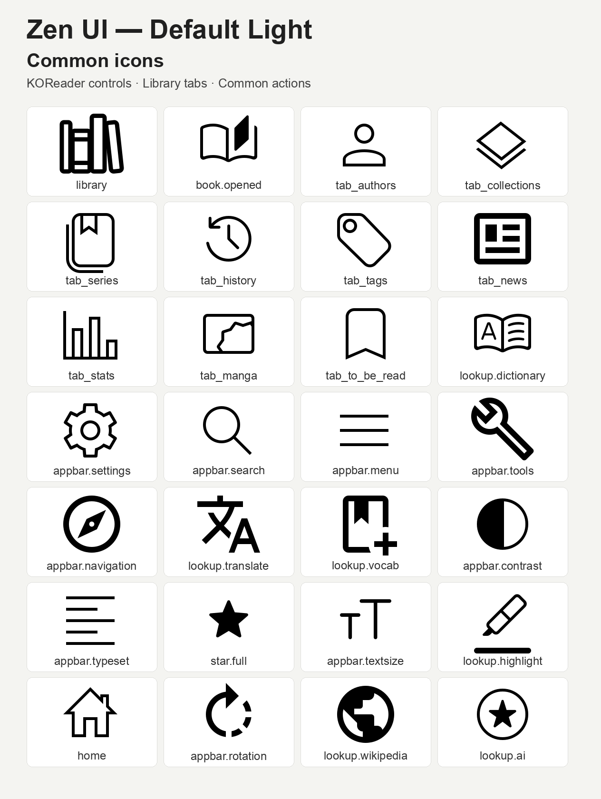
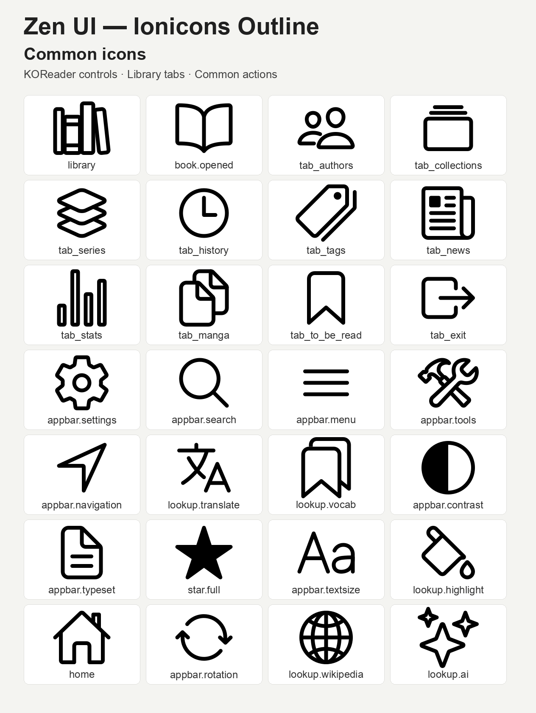
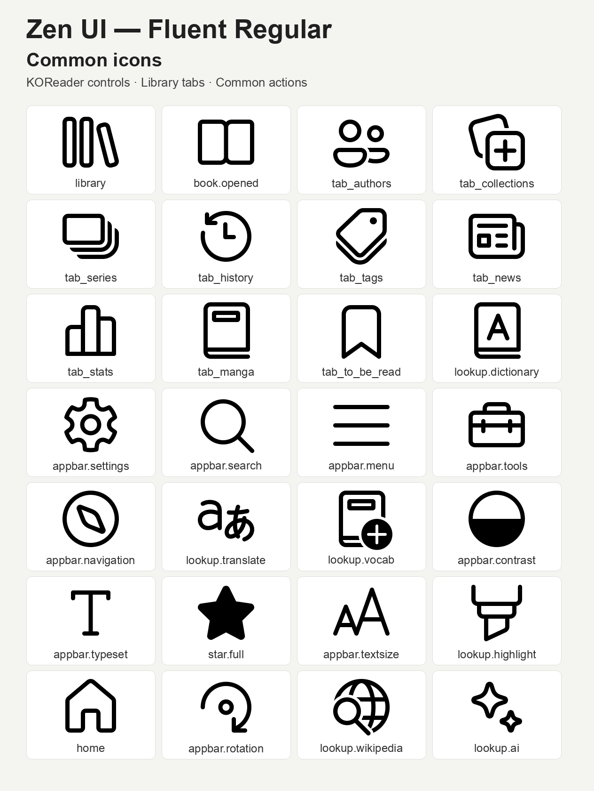
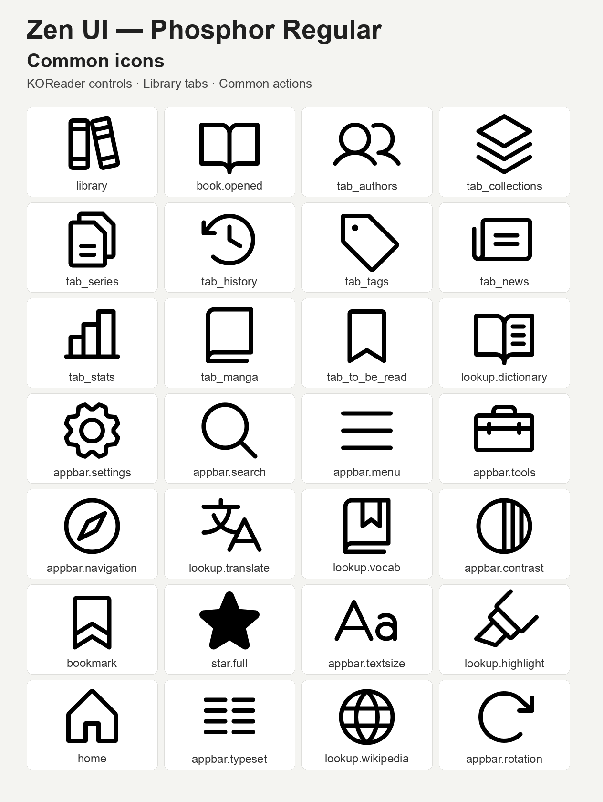

# Zen UI Icon Packs

Four complete, e-ink-friendly icon packs for Zen UI, built from open-source
collections distributed through Iconify. Each pack replaces the same 155
canonical icons.

## Icon overviews

### Default Light



### Ionicons Outline



### Fluent Regular



### Phosphor Regular



| Pack | Style | Release asset |
| --- | --- | --- |
| **Default Light (recommended)** | Material Design Light with selected rounded-outline fallbacks | `zen-ui-default.zip` |
| [Ionicons](https://icon-sets.iconify.design/ion/) | Outline | `zen-ionicons-outline.zip` |
| [Fluent UI System Icons](https://icon-sets.iconify.design/fluent/) | Regular (primarily 24px) | `zen-fluent-regular.zip` |
| [Phosphor](https://icon-sets.iconify.design/ph/) | Regular | `zen-phosphor-regular.zip` |

Download the ZIPs from the repository's
[latest release](https://github.com/xZenLabs/zen-icon-pack/releases/latest).

Reader controls include `pin.svg`, `footnote.svg`, `return.svg`, and the
compatible `return_old.svg` lookup, alongside the highlight style, color,
delete, filter, and sort icons.

## Install a pack

Copy a downloaded ZIP into KOReader's `icons/zen` directory. In KOReader,
enable **Zen UI > Extras > Allow custom icons**, select the pack under
**Custom icon pack**, and restart KOReader. Zen UI expands a valid ZIP
automatically and removes the ZIP only after installation succeeds.

The selected pack is an additional first-priority lookup location. Missing
files continue through the normal bundled icon fallbacks.

## Source layout

Each style keeps category folders directly beside `pack.json`.
Categories without replacement artwork can be absent:

```text
<Style>/
├── pack.json
├── navbar/
├── controls/                 # Quick settings and Zen controls
├── launcher/
├── zenpm/                    # Includes verification shields
├── lookup/
├── menus/                    # Zen menu entry points
├── reader/                   # Page browser: TOC, vocabulary, view modes
├── device/
└── koreader/                 # Stock KOReader icons, including plus/info
```

[ICON-LIST.md](ICON-LIST.md) lists the filenames by category. Page-browser TOC, vocabulary-builder,
and view icons belong in `reader/`. All stock KOReader icons, including `appbar.*`,
the Aa font button, plus/info, bookmarks, and `book_open`, belong in `koreader/`. Quick settings
belong in `controls/`; `tab_left` and `tab_right` belong in `navbar/`.
Shared lookup names appear only once per style;
different lookup names can be edited independently.

The builder flattens the categories into the pack root in release ZIPs,
so installed lookup names and artwork remain unchanged. Missing icons keep their normal bundled fallbacks.

## Build and release

Each pack manifest includes `"color": true` for colour artwork or
`"color": false` for monochrome artwork. Per-style values are retained in the
release ZIPs when building the whole repository.

Build all four release assets locally with Python 3:

```sh
python3 -m unittest discover -s scripts -p 'test_*.py'
python3 scripts/build.py
```

The deterministic ZIPs are written to `dist/`. The build validates each pack's
identity, metadata, SVG structure, and exact match with the 155 canonical
mappings. It also rejects duplicate artwork within the Navbar, top menu,
reader quick settings, and lookup-action groups.

Root `pack.json` holds the shared release version for all packs. Local builds
use that version; pass `--version 1.3.0` to override it in the ZIPs without
changing the source manifests.

GitHub Actions runs the same validation for pull requests and pushes to `main`.
The release workflow also runs manually through **Actions → Release Zen icon
packs → Run workflow**. When a push increases root `pack.json`'s version above
its value on `main` before that push, the workflow releases that exact version.
Otherwise, including manual workflow runs, it increments the patch number above
the higher of root `pack.json` and existing `vMAJOR.MINOR.PATCH` tags.
For example, a manual change from `1.2.0` to `1.3.0` releases `v1.3.0`;
an unchanged manifest with latest tag `v1.3.0` releases `v1.3.1`.
Release runs are serialized to avoid duplicate tags. The workflow tests and
builds all four packs with the selected version, checks each ZIP's manifest,
then creates the tag on the triggering commit and publishes the ZIPs.

Source-icon choices and grouped source paths are recorded in `icon-mappings.json`. To refresh the
committed SVGs from Iconify after changing a mapping, run:

```sh
python3 scripts/update-icons.py
python3 scripts/build.py
```

## Make your own pack

Start with the [Zen icon pack template](https://github.com/xZenLabs/icon-pack-template), or adapt an existing pack below.

Copy one of the folders under `packs/`, rename it, and update `id` and `name`
in `pack.json`, then replace any canonical `.svg` files. The folder name and
`id` must match. Unchanged icons may be removed; Zen UI safely falls back per
icon.

Edit icons in their source categories and preserve their filenames. Release ZIPs
flatten the icons into the pack root. SVG is preferred.
Use transparent artwork that remains legible in black and white on e-ink
screens. `icon-mappings.json` contains the complete filename reference.

## Licensing

Each pack includes its upstream copyright and license notice. Icon data is
provided by [Iconify](https://iconify.design/); source collections and
individual mappings are documented in `icon-mappings.json`.
